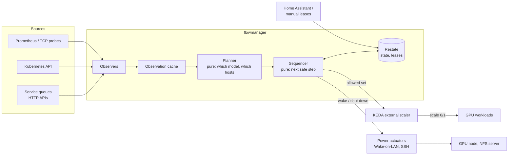

# flowmanager

[](https://github.com/paulcollinsiii/flowmanager/actions/workflows/ci.yml)
[](#license)
[](Cargo.toml)

flowmanager decides what runs on a scarce, power-hungry machine in a homelab Kubernetes
cluster, and when that machine is on.

**Why it exists.** A typical homelab has one GPU node, and several services want it: document
OCR, an LLM, speech-to-text, photo machine learning. Each loads a large model, and the GPU
holds one at a time. Left alone, the services fight over the GPU, and the node stays on all
day, drawing power for work that arrives in bursts. Switching it off by hand is a chore, and
doing it automatically isn't safe without checks. An autoscaler such as KEDA scales each
workload on its own signal, but it can't choose between workloads that share one GPU or one
host.

**What it does.** flowmanager watches each service's work queue and the state of the hosts.
It picks which model owns the GPU next, tells KEDA what may run through KEDA's external scaler
protocol, and can wake hosts with Wake-on-LAN and shut them down over SSH once nothing needs
them. Before a shutdown it checks that no pod still uses the host. The GPU node is on only
while there is work for it. It is written in Rust and keeps its decisions and leases in
Restate, so they survive a restart.



The planner and sequencer are pure crates: no I/O, no clock, deterministic from a snapshot.
Everything that touches the outside world sits at the edges. Details are in
[docs/architecture.md](docs/architecture.md).

## Documentation

Start at [docs/README.md](docs/README.md), the index of all pages by reader. Common entry
points: [overview](docs/overview.md) and [install](docs/install.md).

## How this was built

[Claude Code](https://claude.com/claude-code) wrote the code, the tests and most of the
documentation. Most commits carry a `Co-Authored-By: Claude` trailer. I was the architect and
product owner: I set the problem and the requirements, made the design and policy decisions,
and reviewed the results. When the design changed, I made the call.

What I contributed is visible in the repo:

- [CLAUDE.md](CLAUDE.md) sets the working process, three agent roles that can't see each
  other's state. An *Orchestrator* sequences the work. An *Implementor* builds one phase
  without seeing the acceptance criteria. A *Reviewer* checks the phase against those
  criteria and against the agreed model documents, runs every command itself, and never sees
  the Implementor's report. The point is to keep agents from writing to the test, or from
  trusting a summary of work that is actually broken.
- [planning/](planning/) holds the milestone plans, phase splits and pending proposals, with
  the decisions recorded in them.
- [docs/architecture.md](docs/architecture.md) and
  [docs/architecture/power.md](docs/architecture/power.md) are the model documents and safety
  invariants that every change is reviewed against. A runtime invariant checker enforces them
  on every tick.

## Development

The toolchain (`rust`, `protoc` for the KEDA proto, and the `restate` CLI and server) is
declared in `mise.toml`: `mise install`. The workspace is `crates/*`; the service is
`crates/sched-service`, whose binary is `flowmanager`.

```sh
cargo build --workspace
cargo test --workspace
cargo clippy --workspace --all-targets
cargo fmt
docker build -t flowmanager .          # the release image; see docs/install.md
```

To run it against a local Restate server:

```sh
restate-server &
cargo run -p sched-service -- --config config/example.yaml --backstop 30s
restate deployments register http://localhost:9080
```

Working conventions for agents are in [CLAUDE.md](CLAUDE.md).

## License

Licensed under either of [Apache License, Version 2.0](LICENSE-APACHE) or
[MIT license](LICENSE-MIT), at your option.
