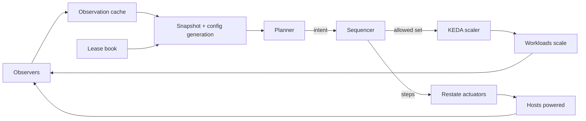

# Architecture

How flowmanager is built and which rules always hold. Terms are defined in
[concepts.md](concepts.md); host power is in [architecture/power.md](architecture/power.md).

Observers feed a cache. The planner and sequencer turn that snapshot into the next step per
resource. KEDA and Restate carry the step out, and the effects are observed on the next pass.

## Components

| Component | Owns | Never does |
| --- | --- | --- |
| Observers | Reading each external source and reporting what they saw (a failed read is reported as failed, never as a reused value) | Decide; write to services; stamp time: the scheduler dates each report on receipt with its own clock |
| Observation cache | The latest observation per source, its age, a dirty flag | Interpret observations |
| Planner | Intent: which model each exclusive resource should serve, which hosts must be up | I/O; read pods, drain timing or transitional state |
| Sequencer | Per-resource state machines; the next safe step toward the intent; the allowed set | I/O; scheduling policy beyond the hysteresis guards (min dwell, idle grace) |
| Lease book | Durable leases: manual model and host leases (including adopted ones), a running job's hold, the lockout | Grant a lease on its own |
| KEDA scaler | Serving the allowed set to KEDA, which converges replicas | Any logic beyond a lookup |
| Restate objects | `Scheduler` (ticks, state, leases), `Recovery` (one per class: re-queue failed items), `Power` (wake and shutdown commands) | Choose when to act; report success as truth without an observation |
| Config loader | Loading, validating and versioning configuration; keeping the last good one | Apply part of an invalid config |

KEDA is level-triggered: flowmanager publishes the desired state and KEDA converges. Restate
actions are edge-triggered: the sequencer invokes one and confirms its effect later by
observation.

## Crates

| Crate | Role | I/O |
| --- | --- | --- |
| `sched-model` | Shared types: snapshot, observation, intent, step, lease, state, config schema; pure queries over them | No |
| `sched-planner` | Policy that turns a snapshot and leases into an intent | No |
| `sched-sequencer` | State machines and safety rules that turn an intent into steps, state and the allowed set | No |
| `sched-observe` | Observer adapters (`kubernetes_watch`, `http_json`, `prometheus`, `tcp_probe`) | Yes |
| `sched-actuate` | Power and recovery actuators; they carry out steps and never decide | Yes |
| `sched-keda` | The KEDA external scaler server | Yes |
| `sched-service` | The binary: Restate wiring, persistence, config delivery, the tick, the invariant checker and replay harness | Yes |

Boundary rules:
- Pure crates depend only on `sched-model`, never on an I/O crate or an async runtime, and
  read no clock: time is an explicit input. Their determinism is invariant 18.
- Service-specific knowledge lives in configuration, never in a crate.

## Tick and events

A tick reads the cached snapshot, runs the planner, then the sequencer, and publishes: the
allowed set to the KEDA scaler and at most one acting step per resource to Restate. It holds
the scheduler's state only briefly.

A tick runs on:
- an observation or source-health change;
- a new config generation;
- a handler call: the lease, lockout, drain, resume, `trigger_job` and `discard_state`
  handlers;
- a periodic backstop (`--backstop`, default 30s), so a missed event cannot leave the
  scheduler stuck.

Observation and config triggers are merged by a debounce (`--trigger-debounce`, default
250ms). A webhook only nudges an `http_json` source to poll now. The `Power` and `Recovery`
objects never request a tick; their effects arrive as observations.

Observers run outside the tick and push into the cache on their own schedules, so a slow
source never delays a decision or a lease request. Every source also has a slow periodic
`resync`, so a missed event cannot leave it stuck. Each observation carries its age, and a
reading older than its limit is unknown; invariant 5 says where freshness is required. No
decision reads pod state, except the veto and recovery.

### Example: OCR to transcription

1. The intent changes to whisperX. The sequencer withdraws mineru's classes from the allowed
   set and waits for in-flight OCR work, but only for `drain_timeout` (or the class's
   `kill_timeout`) from the start of the wind-down.
2. With no work in flight, or at the timeout, one tick on a fresh "up" reading of the host
   removes mineru and allows whisperX together. KEDA scales mineru to 0 and whisperX to 1.
3. Kubernetes keeps the whisperX pod Pending until mineru's pod has released the GPU.

End to end, a model allowed at `t0` is replaced by about `t0 + max_dwell + drain_timeout`
when another model has runnable work and no `none` class of the serving model is busy. That
bound holds only while the intent stays away from the serving model. If it flickers back (a
waiting queue reading 0 for one tick, or the serving class's demand going stale for one
tick) the wind-down is dropped and its clock restarts, which can postpone the switch
indefinitely. Timeouts by cause and host kind are in
[architecture/power.md](architecture/power.md#timeouts).

## Configuration and extensibility

Kinds live in code and instances in configuration.

| Concern | Lives in | Changes when |
| --- | --- | --- |
| Policy logic | Code (`sched-planner`) | Scheduling behaviour changes |
| Policy parameters (dwell, grace, age threshold) | Config | Tuning |
| Resource kinds (exclusive, shared) | Code | Almost never |
| Resources, models, workload classes | Config | Hardware, model or service added |
| Observer kinds | Code (`sched-observe`) | A new protocol is needed |
| Source instances (endpoint, query, field extraction) | Config | A service is added |
| Power actuator kinds | Code (`sched-actuate`) | New power hardware |

Adding a service takes its Deployment, a ScaledObject pointing at the scaler with `model:
<id>` or `class: <id>` in its metadata, one class entry and one source entry. The planner and
sequencer do not change.

Delivery: the config is a file, in production a mounted ConfigMap. It is re-read every
`--reload-interval` (default 5s) and validated in full (invariant 20). A rejected or
unreadable config changes nothing. Each tick takes one config generation and uses it
throughout (`crates/sched-service/src/config_source.rs`).

Removal: a model removed from the config while allowed leaves the allowed set at the next
tick; its pods then scale down and nothing waits for them. A removed class is not
configured, so it is not allowed from the next tick.

## Durable state

Restate keeps this for the `Scheduler` object and its companions
(`crates/sched-service/src/persist.rs`). A value that cannot be decoded, or was written by a
newer build, is reported rather than retried ([operations.md](operations.md#reading-and-changing-state)).
A `scheduler_state` of an older version is dropped at the first tick and the scheduler starts
from observation; leases and jobs are kept.

| Key | Holds |
| --- | --- |
| `scheduler_state` | The sequencer state (per-resource phase, wind-downs, shutdowns) and which sources have ever reported |
| `lease_book` | All leases |
| `job_book` | Scheduled jobs' state |
| `recovery_attempts` | The recovery action's per-item attempts, per class |
| `power_last_action` | The last power action per resource; informational, never read back to decide |
| `backstop_epoch` | The backstop chain's epoch, so a superseded chain ends |

## Safety invariants

These hold whatever the policy or configuration. The numbers are cited by
`crates/sched-service/src/invariants.rs` and `crates/sched-sequencer/src/lib.rs`. Invariants
6 to 15 (host power) are in [architecture/power.md](architecture/power.md#invariants).

"Held by" says how each is kept: `invariants.rs` checks one decision; property and replay
tests compare decisions; the others are structural.

| # | Rule | Held by |
| --- | --- | --- |
| 1 | At most one model is allowed on an exclusive resource. A switch withdraws the old and allows the new in one decision, and only an allowed model is withdrawn | checked by `invariants.rs` |
| 2 | Kubernetes enforces GPU exclusivity: every GPU workload requests `nvidia.com/gpu: 1`, the node exposes one GPU (no time-slicing or MIG) and is tainted. Decisions never read pod state, so the new pod waits for the old to release the GPU | deployment requirement; property tests check decisions ignore pods |
| 3 | A model is allowed only if configured on that resource, only on a host observed up, and never on a locked-out host except while winding down; a newly allowed model needs an allow step in the same decision. A class is allowed only while its host is up and not locked out, its model is allowed and not winding down, its intake is not paused and, if switched, its switch allows it (21). The one exception: a shared host's consumers stay allowed while a lockout's withdrawal is pending (rule 14) | checked by `invariants.rs` |
| 4 | A resource gets at most one acting step per tick, except a switch | checked by `invariants.rs` |
| 5 | Allowing a model on a powered resource, or powering a host off, needs a reachability reading newer than `host_reading_stale_after` showing it up. Otherwise the sequencer holds, and a switch waits as a whole | checked by `invariants.rs` |
| 16 | Work is switched away from early only for a class that declares it safe, or when forced (lockout, manual model lease, requested shutdown). Every switch gives in-flight work only a timeout; a busy `none` class holds an unforced switch without one. A class's in-flight work is stopped only if it is in flight and only in that class's own running wind-down for the current cause, when the class's own timeout runs out ([Timeouts](architecture/power.md#timeouts)). A manual model lease pins its model against batch eviction. A model is not withdrawn before `min_dwell` unless forced. Unknown and offline demand: [Offline demand](architecture/power.md#offline-demand) | checked by `invariants.rs` |
| 17 | A recovery action runs only for a class in the allowed set that declares one, and only for failed items a fresh reading reports | checked by `invariants.rs` |
| 18 | Planner and sequencer are deterministic and side-effect free: the same snapshot and config give the same result, so a tick can be repeated or replayed. Each tick is pinned to one config generation; a mismatched snapshot is an error | type of the tick (`TickError::GenerationMismatch`); replay and property tests |
| 19 | Only the planner and sequencer decide; actuators, observers and KEDA carry out or report and never decide | structural |
| 20 | An invalid config never replaces the last good one | config loader |
| 21 | A switched class is allowed only while a fresh switch reading says `on`, or while a graceful `off` waits: a dependent reports in-flight or unknown demand and less than `drain_timeout` has passed since `off` was first read. A missing, stale or unmapped reading is `off-now`. `off-now` ends a wait at once and `on` cancels it; while it waits, the dependents' ready work wants no model and wakes no host. Host rules come first: a lockout or a requested shutdown of a host the class requires withdraws it by that host's rules, whatever the switch says | checked by `invariants.rs` |
