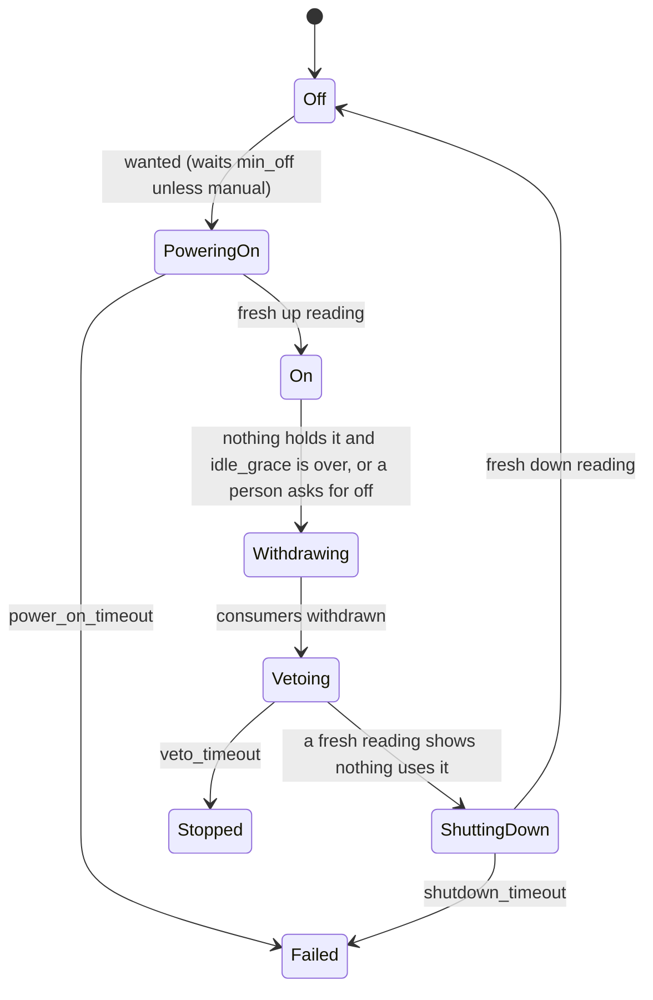

# Host power

How flowmanager owns and changes a host's power. Terms are in [concepts.md](../concepts.md);
the other invariants are in [architecture.md](../architecture.md#safety-invariants).

Only a resource with a `power` section takes part, and flowmanager changes its power only
under `control: managed`. Under `manual` the phase follows observation and no power step is
emitted. The exception is a [lockout](#actions), which applies to any resource with a power
section, `manual` included; only its shutdown needs `managed`. A lockout lease on a resource
without a power section is ignored and reported as a wait.

What wants a host up (`intent.power_up`): a manual host or model lease, a scheduled job's
shared hold, and a [waker](#wakers). A lockout removes the want.

## Lifecycle

Withdrawing, Vetoing and Stopped are the axes of a [shutdown](#state) while the phase is
`on`.

| Stage | Meaning |
| --- | --- |
| Withdrawing | The host's consumers leave the allowed set: on an exclusive host the model wind-down, on a shared host scaling the classes that need it down. Graceful waits for in-flight work up to a timeout ([Timeouts](#timeouts)); immediate does not wait. Unknown demand counts as in flight ([Offline demand](#offline-demand)) |
| Vetoing | A fresh reading must show nothing still uses the host ([Veto](#veto)) |
| ShuttingDown | The power-off command was sent; waiting to observe the host down |
| Failed | A transition timed out (invariant 9). Clears when a fresh reading shows the state the transition was after, on `resume`, or under manual control |
| Stopped | The veto timed out. The host stays up, flowmanager alerts and does not retry. Clears on `resume`, a new manual lease, or the host being seen down |

Cancellation, during Withdrawing or Vetoing:

| Shutdown | Cancelled by |
| --- | --- |
| Idle | Any hold arriving |
| Requested | A new manual lease; a graceful one that is not stopped also by a waker ([Wakers](#wakers)) |
| Stopped | Never by a waker: it never powers the host off, so nothing bounces |

## State

Per resource (`crates/sched-model/src/state.rs`).

| Phase | Meaning |
| --- | --- |
| `off` (with `ours`) | Down |
| `powering_on` | Wake sent, waiting for an up reading |
| `on` (with `ours`) | Up |
| `shutting_down` | Power-off sent |
| `failed` | A transition timed out; records which |

`ours` exists only on `off` and `on`: whether flowmanager started the host and so powers it
down when nothing holds it.

| `ours` | Effect |
| --- | --- |
| Set | By flowmanager's own power-on, whatever wanted the host; by a manual want; by a person's `off` or `off-now` request |
| Kept | Across a blip (`on`, `off`, `on`) |
| Cleared | By a confirmed shutdown, a failed transition, manual control, a stopped veto, an adopted lease ending because the host went down, the host being seen off under a lockout, or a locked-down host being found up |

A `Shutdown` exists only while a host is up and on its way down. Its fields are private and
every transition is a method, so a combination that cannot occur cannot be built or read back.

| Axis | Values |
| --- | --- |
| Cause | `idle`; `requested` (graceful or immediate); `lockout` |
| Withdrawal | `pending`; `done`; `not needed` |
| Veto | `none`; `vetoing`; `stopped` |

An idle shutdown starts with its withdrawal already done (a shared host's consumers leave in
the same tick) or not needed (an exclusive host's model is already gone). Requested and
lockout shutdowns start `pending`, except a lockout with no consumers to withdraw.

| State field | Purpose |
| --- | --- |
| `locked_down` | The host was seen off under a lockout, so the lockout has done its one shutdown. Set when seen off under a lockout (also a lockout taken while it is off); cleared the tick no lockout applies; never set under manual control. While set, a host that is up is left alone: not powered off, not adopted, not given work |
| `off_since` | When the host was observed down after flowmanager shut it down (or after a failed shutdown), for [`min_off`](#min_off). Absent for a host found down or gone down by itself, for a resource without `min_off`, and once the phase leaves `off` |

## Ownership and adoption

- A host flowmanager powers on is flowmanager's, whatever wanted it (a job's hold, a waker, a
  manual lease). It goes down through the shutdown stages when nothing holds it and
  `idle_grace` is over. A backup that woke basestar lets it power down when the job ends.
- A host *found running* is adopted at once, even while a job holds it, and with an
  unreadable job book. It is up on a fresh reading, has a power section under managed
  control, is not `powering_on` or `ours`, has no stopped shutdown, no manual host lease yet
  and no active lockout lease (`crates/sched-sequencer/src/adopt.rs`). That covers a power
  button, a manual wake, a host found running after state loss, one that came up after
  flowmanager's own power-on timed out (an alert is already out, so a person decides), and one
  whose lockout was cleared while it was up.
- Adoption mints a manual host lease with `origin: adopted`, visible in `/v1/leases`, held
  until released or switched off, and ended when the host is seen down. A host flowmanager
  woke is never adopted.
- A manual lease always keeps a host up, on top of anything else: taking one while a backup
  runs keeps basestar up afterwards.

## Wakers

A host's wakers are the classes that would power it back on if it went down now: each class
with `may_change_power` that requires the host and is busy (ready or in-flight work), or is a
switched class reading `on`. A job's hold is not a waker; it is a lease, which a graceful
shutdown already waits for. Unknown demand is not a waker. A locked-out host has none. One
pure function lists them (`crates/sched-model/src/wakers.rs`); the planner's wake and the
shutdown logic both read it.

| Action | With wakers |
| --- | --- |
| `off` (graceful) | Refused, judged on the last tick; nothing changes and the refusal names each waker and why (the toggle answers `409`). A waker appearing later cancels a graceful shutdown already under way, before power-off |
| `off-now` | Never refused; accepted with a warning that the wakers will power the host back on after `min_off`, in effect a reboot |

Wakers are reported with each host's status, so a person can see why `off` would be refused.

## Offline demand

A class with a demand source but no usable reading is *offline* or *unknown*, decided afresh
on every read by `class_work` and never stored. It is offline when a fresh reading shows a
host the class requires is down, or when the switched class its source reads from is off
(graceful wait over). Offline demand is no work: it holds no model and no host, nothing is
stopped for it, and it does not prevent `idle`. Otherwise it is unknown, which holds a model
and a host as if work existed.

A fresh demand reading wins over a host-down offline case, so queued work reported while the
host is down still holds a model and a host. It does not win over a switch-off: a person
turned the app off, and the graceful wait is how its in-flight work is honoured.

## Actions

The same vocabulary on shared and exclusive hosts.

| Action | Meaning |
| --- | --- |
| `on` | Take a manual host lease; power on if off |
| `release` | Drop the lease. The host goes down when idle like any other; release never shuts it down by itself |
| `off` | Requested shutdown, graceful. Refused while the host has wakers |
| `off-now` | Requested shutdown, immediate. Never refused; anything may wake the host again afterwards |
| `resume` | Clear a `Stopped` shutdown or a failed transition (`crates/sched-service/src/resume.rs`) |
| `lockout` on / off | Below |

On an exclusive host Withdrawing is the mode wind-down, so `off` and `off-now` add nothing
new there. `off` and `off-now` apply to a managed host that is up and not locked out.

**Lockout** means "keep away from this host until I clear it". It forces the withdrawal,
shuts the host down once (managed control only), and then nothing wakes, adopts or schedules
it: no waker, job hold or manual lease. While locked out the host may be up running something
else (another OS, physical work); flowmanager neither adopts nor powers it off. Clearing the
lockout returns the host to the normal model: if it is up it is found running and adopted; if
it is off it is woken only if something wants it.

While a lockout's withdrawal is pending, a shared host's consumers stay allowed: the
withdrawal gives their in-flight work `lockout_timeout` ([Timeouts](#timeouts)). An exclusive
host's classes never stay allowed.

**A lockout takes over a shutdown in progress.** The shutdown becomes the lockout's. A
withdrawal still pending gives in-flight work `lockout_timeout` from the takeover, whatever
the earlier cause; one already done stays done; an immediate requested shutdown whose
withdrawal is pending stays the person's. Clearing the lockout drops the shutdown, so a
person's earlier `off` does not outlive it.

**A due job under a lockout** does not start, the host up or not; its run waits as for a host
that is not up and keeps its own hold, which is inert while the lockout stands. When the
lockout clears the hold is an ordinary job hold again: it may wake a host that is down so the
run can catch up (per `missed_run`), after which the host is flowmanager's and powers down
when the job ends. A run already running is not killed and keeps its hold, which the lockout
overrides; the veto waits for its pods, up to `veto_timeout`.

## Timeouts

How long in-flight work may run before it is cut off depends on the cause and the host kind.
An exclusive host winds down per class; a shared host withdraws all its consumers together.

| Cause | Exclusive host (model wind-down, per class) | Shared host (consumers withdrawn together) |
| --- | --- | --- |
| Planner switches models | The class's `kill_timeout`, else `drain_timeout` | Does not happen |
| Manual model lease | `kill_timeout`, else `drain_timeout` | Does not happen |
| Lockout | `kill_timeout`, else `lockout_timeout` | `lockout_timeout` |
| Graceful requested `off` | Exactly `drain_timeout` from the request; `kill_timeout` does not apply | `drain_timeout` |
| `off-now` | 0 | 0 |
| Idle shutdown | Nothing to withdraw: the model was already released | Nothing to wait for: consumers leave in the tick it starts |

All of these end early when nothing is in flight. `lockout_timeout` defaults to
`drain_timeout`.

Reasons:
- `kill_timeout` is honoured only in an exclusive host's model wind-down; a shared host has
  no per-class clock. The difference is deliberate.
- A person's graceful `off` gets a predictable bound, `drain_timeout` from the request, that
  no earlier wind-down's start changes. A lockout, being stricter, keeps its own timeout.
- On an exclusive host each class is cut off at its own timeout, but the model is withdrawn
  only when no class still blocks, so the bound is the largest blocking timeout.
- A lockout starting or ending mid wind-down restarts the clock. A lockout ending gives the
  work a fresh `drain_timeout`. Switch, manual lease and release share `drain_timeout` and
  keep the start, so the cut-off neither moves nor is extended by them.

Code: `crates/sched-sequencer/src/exclusive.rs`, `power.rs` (`graceful_wait_over`).

## Veto

Before any power-off (idle, requested or lockout) a fresh reading must show nothing uses the
host. Every reading that applies must be clear:

| Reading | Applies when | Clear when |
| --- | --- | --- |
| `mounts` | A `mounts` source names the host's NFS server | Zero pods mount it |
| `pods` | The host has models and a source observes `pods` | Zero pods of every model. A model whose `namespaces` are not all listed in some `pods` source's `namespaces` is not covered and reads as unknown, never zero |

A missing, stale, failed or uncovered reading is unknown and counts as in use: the shutdown
waits. At `veto_timeout` the shutdown is `Stopped` ([Lifecycle](#lifecycle)). A host with
no applicable reading has no veto (`Config::veto_readings`,
`crates/sched-model/src/config.rs`).

## min_off

After a shutdown flowmanager started and saw confirmed, an automatic power-on (a waker, a
job's hold) waits for `power.min_off` (default 0, no wait), counted from `off_since`. A manual
lease does not wait. A host found down, or gone down by itself, is not penalised. The wait
only delays a fresh decision; it is never a retry.

## Who decides what

| Concern | Decided by |
| --- | --- |
| Adoption | A pure sequencer function, `adopt::adopt` (`crates/sched-sequencer/src/adopt.rs`), applied in `crates/sched-service/src/tick.rs` |
| Host status | One `HostStatus` per resource, derived by `status::derive` (`crates/sched-sequencer/src/status.rs`) from the config, the snapshot, the decided state and steps. It carries the phase, `ours`, exclusive mode, shutdown (cause, withdrawal, veto and its blockers), lockout (held, withdrawing, left alone), lease and origin, `min_off`, the wait reason and `attention`. The report, reason text, logs, metrics and toggle listener read it. A failed tick (the core refused to decide) carries the statuses of the carried previous state and no events |
| One-time events | `HostEvent` (power timeout, veto timeout, adoption, adoption ended), derived in the same function from the previous and next state. An event is an edge and a status a level. Events are part of the journaled outcome, so a replayed tick has the same events; the service alerts and counts only when it decided the tick, and logs a replay at info level (`publish`) |
| "Is it locked out" | `Config::locked_out`: an active lockout lease on a resource with a power section. The invariant checker keeps its own on purpose |
| Toggle text | Pure functions in `crates/sched-sequencer/src/switch.rs` (`host_switch`, `model_status`, `lockout_status`); `any_needs_attention` is the listing's roll-up: any status with `attention` whose resource has a power section |
| Toggle listener | Routes and translates only: it fetches inputs, calls those functions and words the answers. No status logic, no branch on resource kind |

A failed power request is not derived from state: it is the service's record of what the
`Power` object reported (`TickReport.power_request_failures`).

## Invariants

Invariants 1 to 5 and 16 to 21 are in [architecture.md](../architecture.md#safety-invariants).
"Held by" has the same meaning there. Each row states the rule; the sections above hold the
detail.

| # | Rule | Held by |
| --- | --- | --- |
| 6 | Power changes come only from `power_up` (see the top of this page). A host under `control: manual` never gets a power step | checked by `invariants.rs` |
| 7 | flowmanager powers a host off only if it owns it: the previous state shows `ours`, or it is a lockout's one shutdown ([Ownership](#ownership-and-adoption)) | checked by `invariants.rs` |
| 8 | An automatic power-on waits for `min_off` after a confirmed shutdown ([min_off](#min_off)) | checked by `invariants.rs` |
| 9 | A power transition is bounded by `power_on_timeout` or `shutdown_timeout`. On expiry the resource is `failed`: nothing is allowed on it and no power step is emitted for it. Other resources are unaffected | checked by `invariants.rs` |
| 10 | A host is never powered down while a lease holds it (manual, adopted, job hold), while a class that needs it has or may have work ([Offline demand](#offline-demand)), while a switched class that requires it reads `on`, or while a model is allowed on it; nor before `idle_grace` ends. Two overrides: a requested shutdown overrides work and waives the grace, but not a lease; a lockout overrides work and leases | checked by `invariants.rs` (including "no model allowed at power-off") |
| 11 | Consumers are withdrawn before power-off, within the bound in [Timeouts](#timeouts) | checked by `invariants.rs` for a shared host (consumers scaled down first, lockout timeout honoured); for an exclusive host the "no model allowed at power-off" check is reported as 10 |
| 12 | Shutdowns are cancelled only as in [Lifecycle](#lifecycle) | checked by `invariants.rs` for the idle case; sequencer tests for the rest |
| 13 | A host is powered off only after the [veto](#veto) is clear | checked by `invariants.rs` |
| 14 | While locked out, nothing wakes, adopts or schedules the host, and it is shut down once; a shared host's consumers stay allowed only while the withdrawal is pending ([Actions](#actions)) | checked by `invariants.rs` (no model or class allowed, no power-on, no power-off after the first confirmed off, shared withdrawal first); "nothing adopted" and "no job starts" by `crates/sched-sequencer/tests/adopt.rs` and the service tick tests |
| 15 | A host found running gets an adopted lease at once ([Ownership](#ownership-and-adoption)) | not checked by `invariants.rs` (it checks power steps, not leases); decided by `adopt::adopt`; tested in `crates/sched-sequencer/tests/adopt.rs` and `crates/sched-service/src/jobs/scenarios/ownership.rs` |
